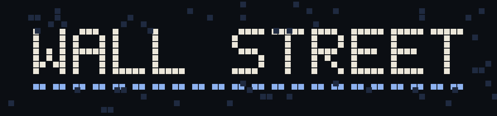
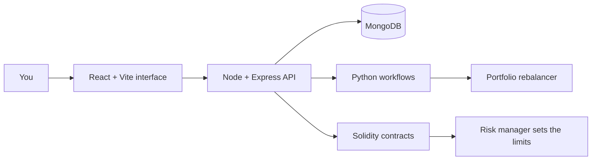

<div align="center">



### Agent-driven finance, built in the open.

*Formerly known as **LokiAI**.*

**The first project ever built by the founder of [THE SHRIKS](https://github.com/THE-SHRIKS).**

`status: in development` · `stack: React + Node + Python + Solidity` · `first of many`

[Watch the demo](https://drive.google.com/file/d/1nLhSK99C3LHHQoPAALbXomUnGBvWeUlN/view?usp=sharing) · [Run it](#run-it) · [Read the map](#whats-inside) · [See the website](#the-website)

</div>

---

## The first one

> **Name change.** This project started life as **LokiAI** (also written Loki.AI). It was renamed **Wall Street**. The code still carries the old name in places, for example the `LokiAi/` folder, so if you see LokiAI anywhere, it is this same project.

Every builder has a first project: the one that is too big, too ambitious, and teaches more than any tutorial could.

**Wall Street is that project for the founder of THE SHRIKS.**

It started with a simple question: *what would finance look like if autonomous agents did the watching, the comparing and the rebalancing, while people kept the rules?* Answering it meant learning, in one repository, how to build a React interface, a Node API, Python workflows and Solidity contracts, and how to make them talk to each other.

It is not finished, and it does not pretend to be. Some parts are real code that runs. Some are prototypes. Some are simulations standing in for something that is still to be built. This README says which is which, because honesty about a first project is part of what it has to teach.

## The idea

Four agents, each with one job, and a human who sets the limits.

| Agent | The job | Where it lives |
| :-- | :-- | :-- |
| **Yield optimizer** | Compare strategy candidates and look for better places to put capital. | `loki-contracts/contracts/YieldOptimizer.sol` |
| **Arbitrage bot** | Explore price differences between routes. | `loki-contracts/contracts/ArbitrageBot.sol` |
| **Risk manager** | Hold the thresholds that keep the other agents in bounds. | `loki-contracts/contracts/RiskManager.sol` |
| **Portfolio rebalancer** | Propose a rebalance, then simulate the execution step. | `portfolio_rebalancer/` and `PortfolioRebalancer.sol` |

## Where things honestly stand

| Part | Status | What that means |
| :-- | :-- | :-- |
| Browser application | In development | A React, TypeScript and Vite interface. Some screens run on seeded or simulated data. |
| API and data | In development | A Node and Express service with MongoDB-oriented models. |
| Python workflows | Prototype | Allocation analysis and a task gateway. The trade step is simulated. |
| Solidity contracts | Prototype | Four contracts with Hardhat tooling. Not audited, not a deployment record. |
| Docker setup | Provided, not re-verified | Compose files for the app, API and database. Check them before relying on them. |
| Real funds | Not supported | Nothing here should touch real money. |

## What's inside

```
Wall Street
├── LokiAi/              the React app, the Node API and the Docker setup
├── loki-contracts/      four Solidity contracts and Hardhat scripts
├── portfolio_rebalancer/  Python allocation analysis and the rebalance engine
└── task_gateway/        a small FastAPI task gateway
```

## How the pieces connect



## Run it

You need Node.js. Docker, Python and Hardhat are optional, depending on what you want to explore.

**1. The interface**

```bash
cd LokiAi
npm install
npm run dev
```

Vite serves it at `http://localhost:5173`.

**2. The whole local stack with Docker**

```bash
cd LokiAi
docker compose up --build
```

This starts the database, the API (port 5000) and the interface. Copy `LokiAi/config/env.example` and fill in your own values first. Never commit real keys.

**3. The contracts**

```bash
cd loki-contracts
npm install
npx hardhat compile
```

**4. The Python rebalancer**

```bash
cd portfolio_rebalancer
python -m venv .venv
pip install -r requirements.txt
```

## The website

A public website for the project lives on the [`website`](../../tree/website) branch, in the `website/` folder. It is built with Astro and links every claim it makes back to the code.

## What building it taught

- A first project is allowed to be messy. The cleanup is part of the work.
- Labelling a simulation as a simulation is a feature, not an apology.
- Four small agents with clear limits beat one clever agent with none.
- Shipping in the open keeps you honest.

## Notes

Wall Street is a learning project and a work in progress. It is not financial advice, it has not been audited, and it should not be used with real funds. Interfaces and folder layout may change.

<div align="center">

---

**Wall Street** · the first project of the founder of **THE SHRIKS**

*Everyone starts somewhere. This is where it started.*

</div>
